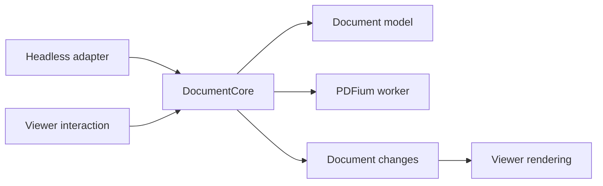

# Architecture overview

React Native InkSign PDF is a Fabric/Nitro module for signing ordered PDF
documents through a viewer or headless API. JavaScript composes the
screen and sends commands; native code owns
document bytes, page presentation, input conversion, committed content, history,
and export.

## System boundaries

- `src/InkSignView.nitro.ts` and `src/InkSignDocument.nitro.ts` define native interfaces; `src/index.ts` defines
  React session props. JS receives state/page events, prepared text metadata,
  and selection IDs, not PDF data or per-frame geometry.
- [`src/index.ts`](../../../../src/index.ts) validates public arguments before
  native dispatch. Platforms check document-dependent bounds when admitting a
  command; loaders validate PDF, image, and OS data at ingress.
- The stable React ref buffers async calls until native attachment, in invocation
  order. Immediate close/teardown reject undelivered work; synchronous calls
  require attachment. Strict Mode replay and Suspense hiding preserve the connection.
- `initialDocument` loads a local PDF/JPEG path or `file://` URI once per keyed
  session; errors use `onStateChange.error`. JPEG detection uses file bytes and
  the shared encoder creates one A4 page. Caller files remain unchanged.
- Public placement/focus use displayed top-left page points. Text bounds have
  physical edges independent of direction; dimensioned taps extend right/down.
  Dimensions are hard limits; `maxLines` caps complete lines without forcing a
  count. Preview/export share retained lines. Bounded editors admit fitting input,
  allow deletion, and retain text through reflow; programmatic values clip overflow.
  Text placement with both dimensions omitted auto-sizes the live editor as text
  wraps or new lines are entered.
- `addPages()` selects the current, first added, or last added page through
  `activePage`; the default keeps the current page, or selects the first page
  when creating a document. Empty and cancelled imports leave document state
  unchanged.
- Image imports use configurable DPI and JPEG quality, with defaults of 200 DPI
  and 0.72. Rasterization preserves page aspect ratio; explicit DPI is capped
  by source resolution. PDF inputs retain their original pages.
- Each document owner has independent published state: stable ordered pages,
  active page, committed content, and operation identity. The UI thread owns
  presentation/callbacks; backend publication uses validated detached candidates.
- Android renders PDFium tiles beneath native annotation presentation and uses
  the shared C++ stroke engine. iOS renders PDFKit pages through Quartz and
  uses PencilKit for ink input; export retains source pages and adds committed
  text and filled vector signatures as PDF annotations.

## State inspection and events

- Page `getState()` reports stable identity, current index/count, displayed width/height in
  1/72-inch points, and clockwise rotation in degrees (0/90/180/270). Text inputs
  and returned entry bounds use that displayed top-left coordinate space.
  Stable page inspection does not activate the page.
- Page state adds committed-content `hasInk`/`hasText`, page-content dirty state,
  and undo/redo availability. Reads use in-memory state without backend parsing.
  Content-presence flags inspect committed entries; dirty/history fields read stack
  metadata. Page dirty state excludes document structural changes.
- `onPageChange` carries `PageChangeEvent`: page identity, geometry,
  and undo/redo availability. Content-presence flags and page dirty state belong to
  imperative `PageInfo` reads. Event snapshots are constructed without content scans.
- `onStateChange` adds active `pageIndex`, mode, and load error to document state.
  Navigation updates index and count together; `pageIndex` is null without a
  document. Headless document state has no active-page index. Page `getState()`
  retains that page's own current index/count.
- `hasInk`/`hasText` inspect only committed InkSign content in the current
  session. Live input, drafts, and imported PDF content, including Ink annotations and
  exported InkSign paths on reopen, are excluded. Export preserves visible ink
  without restoring editable session history.
- Viewer/document `getState()` returns document-wide identity, page count, and
  dirty state, including structural changes and applied tracked edits on any page.
- Page dirty state is derived from applied tracked history: it equals `canUndo`.
  Untracked content and redo-only history are clean. Document dirty state also
  includes structural changes. State reporting uses history metadata without
  scanning committed content. Export leaves history and dirty state unchanged.
- Events deduplicate their reported fields. Edits emit only when
  those fields change. Page events carry no index/count, dirty, or content flags.
  Deferred interaction transactions publish their final state.

## Document ownership

Shared requirements define API behavior; neither platform is the reference
implementation. Platform discoveries inform corrections to both implementations.

Android `DocumentCore` and Swift `InkSignDocumentCore` own asynchronous FIFO,
synchronous committed edits, ordered stable pages/targets, history, analysis,
fonts, export, and cleanup. PDFium work runs on the serial backend executor;
CoreText shapes iOS text and HarfBuzz shapes Android text.

Viewers own active-page selection, rendering, gestures, drafts, selection, and
viewport readiness. They submit explicit-page edits and consume committed
changes. Core publication succeeds independently of optional presentation;
viewer commands may additionally await installation. PDFKit objects and working
file presentation leases stay in the Swift viewer adapter.

Both platforms support headless `openDoc()` and named-font loading. Resource and
publication contracts: [Android lifecycle](android/view-lifecycle.md),
[iOS lifecycle](swift-ios/view-lifecycle.md). Platform shaping/embedding policy:
[Android export](android/export.md), [iOS export](swift-ios/export.md).

## Document model

- Page order is document state; active-page identity belongs to viewer state.
  Ink and text are
  committed per-page content; active gestures, predictions, editor drafts, and
  selection are temporary presentation state.
- Prepared pages bind immutable source analysis to a stable page ID. Async
  preparation enables synchronous resolution/value operations on that captured
  page. The coordinator owns numeric input target IDs, target metadata, and committed
  content; the overlay owns drafts/selection. IDs are monotonic per document owner.
  Analysis lifetime follows the platform lifecycle references.
- `resolveInputUnderline()` detects a label and adjacent writing guide;
  `createInputArea()` defines an explicit rectangle. Both return input target IDs
  used by text-value/formatting methods and `getInputTarget(s)`. Viewer page handles
  additionally expose `focusInputTarget()`.
- Field lookup compares complete joined labels first, then token frequencies
  when no joined match exists. Repeated words matter; fallback allows extracted
  word-order differences. Partial labels/substrings do not match.
- Value precedence: draft → committed module text → embedded text → empty.
  `setTextValue(id, '')` removes module text and reveals preserved source text.
  Drafts and committed annotations own formatting; target options supply defaults
  for empty targets. Re-resolution preserves formatting. Headless automatic
  direction follows React Native app direction.
- Programmatic text mutations accept per-call `untracked?: boolean`,
  defaulting to false. Untracked edits enter the permanent base without changing
  dirty state; retained tracked edits on the same identity cause the flag
  to be ignored. See [page history](android/view-lifecycle.md#page-history-and-disposal).
  Draft interaction remains tracked; headless cores retain base edits without undo.
- `getSelectedText()` reads overlay selection on the UI thread, returning null
  or a document/page/text-bound handle. It needs no source analysis, retains the
  view weakly, and uses the same value/formatting mutations as prepared pages.
  Deselection/navigation do not invalidate it; document/page/target invalidation
  rejects operations. Selection callbacks remain UI-availability notifications.
- Named detection/adoption uses rule width and one label-height band above a
  bottom-anchored rule, below a top-anchored rule; exclude only selected label
  glyphs. Free targets use placement bounds. Competing module annotations reject
  with `text_target_ambiguous`. Named focus uses the rule; free focus uses center.
  Vertical rules reject new field insertion/focus; existing text stays editable.
- Target bounds, rule endpoints, and detection regions use canonical rotation-zero,
  visible-box-relative top-left coordinates. Named identity uses source glyph ranges
  and rule identity; free bounds are canonicalized before reuse/adoption.
- Annotations retain local layout/flow bounds and captured orientation.
  Layout → canonical → display mapping preserves wrapping. Rotation preserves
  target identity, canonical geometry, layout, and history.
- Named targets keep their source association and detection region when module
  text moves. Free targets track accepted placement, including undo and redo,
  and refresh their embedded fallback from retained immutable source geometry.
- Opens and page mutations prepare detached candidates. Rejected page-mutation
  candidates leave the current document intact. Caller source files are never
  overwritten.
- Finalize exports an immutable snapshot of committed content from the current
  working document to a separate output. It does not consume or replace the
  working document.

## Page tags

- The core assigns one optional, immutable tag to every page loaded by an
  open/import call. Tags are nonempty, nonunique strings matched exactly.
- `getPageIdsByTag(tag)` reads ordered IDs synchronously without analysis.
  `getPage({ tag, index? })` prepares one current match in FIFO order; index defaults
  to zero and missing matches reject with `page_not_found`. Neither changes selection.
- Tags follow page identity through structural edits, appear in page state only,
  and end with the session. Export does not persist them.

## Document operations

- The document owner controls operation identity and cancellation. Native async
  document, preparation, and viewport commands execute FIFO. Ordinary commands
  resolve implicit targets against published state during execution; bound handles
  retain captured identities. Earlier mutations finish before ordinary open/close.
  Replacement/close scheduling cancels presentation requests for the retiring
  document. Synchronous commands and gestures act against current published state.
- `setMode()` requires ready presentation and replaces the mode-session token,
  including same-mode requests. With no document, `setMode('view')` is a no-op
  returning an inactive session; ink/text still require a document.
  Session methods/pages cancel on supersession,
  scheduled replacement/close, or disposal; ordinary pages are document-bound.
  Navigation/reordering and internal text transitions retain the token. Handles
  retain tokens/weak view references; handle disposal does not end the session.
- `requestUserTap()` owns exclusive `pageCoords` input and captures document,
  active page, and geometry revision. Tap waiting releases the command queue.
  Page/geometry/mode changes or teardown cancel it. Direct calls replace the
  session and finish in view mode; session calls restore their originating mode
  after selection/navigation cancellation. Pan/pinch are not selection taps.
- `close()` waits its turn; `close(true)` cancels queued/running callers, invalidates
  late publication, and clears the viewer. Disposal always cancels immediately.
- Viewer opening resolves after loading and presentation installation, reporting
  the initial page through `onPageChange`. Replacement loading clears the previous
  document; a loading failure before commit leaves the viewer empty. Prepared
  handles remain bound to their original document/page and reject after invalidation.
- Headless `close()` is terminal: it immediately rejects new work and synchronous
  reads, drains admitted async commands, invalidates handles, and resolves after
  backend and resource cleanup.
- Successful `addPages()` publication updates the [state snapshots](#state-inspection-and-events).
  First-document creation reports its initial page; imports that leave active-page
  fields unchanged need not emit `onPageChange`. Empty/cancelled imports emit no page event.
- Viewer state includes an opaque document ID and nullable load-error message.
  Starting a load clears the error.
  Modes are `view`, `ink`, `textAdd`, `textEdit`, and `pageCoords`; selection IDs are reported
  separately by `onTextSelectionChange`. Successful opening creates identity;
  page mutations retain it.
  Empty state uses null identity, zero pages, view mode, and a false dirty flag.
- `finalize()` returns a `file://` URI. Output ownership and cleanup follow the
  [Android](android/export.md#snapshot-and-output) or
  [iOS](swift-ios/export.md) export contract.
- Android viewer promises settle within their queued command, before the core
  releases its queue slot. Cancellation before execution settles through command
  completion.
- Check operation identity on the owning thread before publishing mutations,
  emitting asynchronous callbacks, and settling promises. Superseded successes
  and failures reject with `operation_cancelled`; each promise settles once.
  A result already settled before replacement cannot be withdrawn.
- Cancellation does not roll back completed edits. Backend resources stay owned
  until their users finish; export cleanup follows the platform export contract.
  On Android, caller cancellation alone does not interrupt a begun non-cancellable
  commit: matching reader/model publication completes while document identity
  remains current. Replacement/disposal invalidate stale publication.
- Disposal invalidates the session, cancels pending operations, clears callbacks
  and presentation, and releases resources through the same cleanup rules.
- Font-file ownership: [Android lifecycle](android/view-lifecycle.md#fonts).
  iOS named fonts retain owned bytes; CoreText supplies system glyph fallback.
- Required validation covers replacement during each asynchronous operation,
  stale success and failure, empty imports, repeated opens, disposal, exactly-once
  settlement, unchanged newer content/history, and eventual resource cleanup.

## Scope

The v1 surface supports ordered PDFs, PDF and image page insertion, page-local
ink and text, undo/redo, and signed-PDF export. iOS preserves visible source
page content, order, supported boxes, and rotation, and exports module text and
ink as locked annotations with vector appearances. Advanced source PDF
semantics such as forms, links, outlines, tagged structure, layers, scripts,
embedded files, and existing digital signatures are outside the editing
contract; their loss does not block the workflow. Non-mobile platforms and
unrelated PDF extensions are outside this scope.

## Subsystem references

| Area | Reference | Responsibility |
| --- | --- | --- |
| Public API | `src/InkSignView.nitro.ts` | Props, commands, and callbacks. |
| Repository workflow | `development.md` | Source map, project policy, and validation entry points. |
| Android lifecycle and export | `android/view-lifecycle.md`, `android/export.md` | Document publication and output ownership. |
| iOS lifecycle and input | `swift-ios/view-lifecycle.md`, `swift-ios/viewport-input.md` | Document publication, viewport, and input boundaries. |
| iOS rendering and export | `swift-ios/rendering.md`, `swift-ios/export.md` | Presentation state and export representation. |
| C++ stroke engine | `stroke-engine/input-modeling.md`, `stroke-engine/geometry.md`, `stroke-engine/prediction-frames.md` | Shared stroke geometry and platform consumption. |
