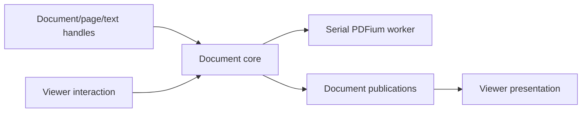

# Architecture

## Ownership and data flow

- `createDocument(options?)` returns an owner synchronously. Optional initial sources
  load first in the FIFO; omitted/empty sources leave it empty. `DocumentCore`
  owns FIFO commands, stable pages/targets, committed content,
  admitted text transactions, history, analysis, fonts, export, and cleanup.
  The backend owns PDF resources, not editing state.
- Document/page/text handles retain the core. `InkSignView.document` attaches one
  viewer per owner; rejected attachment preserves the viewer's existing document.
  The prop is optional and empty owners can attach.
  Detach/unmount settles interaction and releases presentation without closing
  the owner. Ordinary document handles remain usable headlessly.
- Viewers own active-page selection, viewport, gestures, live ink, caret,
  composition, selection, animations, and render caches. They submit explicit-page
  edits and consume publications. Core commands never request drafts from a viewer
  or wait for rendering.
- Android presents PDFium tiles and shared C++ stroke contours. iOS presents
  PDFKit pages, UITextView editing, and PencilKit ink. Both use PDFium for analysis,
  page manipulation, and export. Android shapes with HarfBuzz; iOS with CoreText.
- Native interfaces: `src/InkSignDocument.nitro.ts`, `src/InkSignView.nitro.ts`.
  Shared data contracts live in `src/InkSignTypes.ts`.
  `src/index.ts` validates public arguments and forwards callbacks. Native owners
  validate state-dependent commands; loaders validate external bytes.
- The stable React ref buffers async calls until native attachment in call order.
  Synchronous calls require attachment. Teardown rejects undelivered work;
  Strict Mode replay and Suspense hiding preserve the connection.

Resource contracts: [Android lifecycle](android/view-lifecycle.md),
[iOS lifecycle](swift-ios/view-lifecycle.md).

## State and events

- Document `getState()`: identity, page count, aggregate dirty state. Viewer
  `onStateChange` adds current page index, mode, and nullable error. Empty viewer
  state has null identity/index, zero pages, view mode, and clean state.
- Page `getState()`: stable identity, current index/count, displayed dimensions,
  clockwise rotation (0/90/180/270), `hasInk`, `hasText`, dirty, undo/redo.
  Inspection does not activate the page or parse PDF content.
- Content flags count current-session InkSign content and admitted text. Live ink
  and imported PDF content are excluded. Reopening exports does not restore history.
- Page dirty includes applied tracked history or a changed tracked transaction.
  Redo-only history and untracked content are clean. Structural changes also dirty
  the document. Export preserves dirty/history state.
- `onPageChange` reports installed page ID, geometry, rotation, undo/redo.
  Index/count, dirty, and content flags remain in state reads. Events deduplicate
  reported fields and run on the UI thread. Registering a state/page callback
  delivers its current available snapshot before subsequent deduplication.
- `onTextSelectionChange` reports page/text identity or null, independently of mode
  (`view`, `ink`, `textAdd`, `textEdit`, `pageCoords`).
- `onZoomChange` reports settled scale/fit, deduplicated per page, only with ready
  presentation. Settlement details belong to platform viewport references.

## Geometry and text targets

- Public bounds/focus use displayed top-left page points (1/72 inch).
  `{ x, y, width, height }` has physical edges independent of direction;
  dimensioned taps extend right/down.
- Canonical storage is rotation-zero, visible-box-relative top-left geometry.
  The visible box is CropBox intersected with MediaBox. PDF bottom-left coordinates
  stay in adapters; rotation maps canonical content to display.
- Annotations retain local layout/flow bounds and captured orientation.
  Layout → canonical → display preserves wrapping. Rotation/reorder preserve
  page/target identity, source association, layout, and history.
- Prepared pages bind immutable source analysis to a stable page. Preparation is
  async; target resolution/value/formatting operations are sync. Target IDs are
  numeric and monotonic within the owner.
- `resolveInputUnderline()` pairs a complete extractable label with an adjacent
  horizontal rule in the resolved direction. Occurrence selects first/last eligible
  pair. Match complete joined labels first, then token frequencies; repeated words
  matter, word order may differ, partial labels do not match. Only ASCII case is folded.
- `createInputArea()` resolves explicit bounds. Named identity uses source glyph
  ranges and rule identity; free bounds are canonicalized for reuse. Moving named
  text retains its source association; free targets follow accepted placement,
  including undo/redo.
- Named value detection/adoption uses rule width and one label-height above a
  bottom-anchored rule or below a top-anchored rule, excluding only matched-label
  glyphs. Free targets use their bounds. Competing module annotations reject
  `text_target_ambiguous`.
- Value precedence: core transaction → committed module text → embedded text → `''`.
  Empty writes remove module text and reveal source text. Re-resolution preserves
  formatting; target defaults apply to empty targets.
- Named focus uses the rule; free focus uses its center. Displayed vertical rules
  reject new field insertion/focus; existing text remains editable/clearable.
- `getSelectedText()` returns null or a core-retaining text handle. Selection and
  navigation changes preserve it; document/page/target invalidation rejects use.

### Layout and editing

- Dimensions are hard limits; `maxLines` caps complete lines without forcing a
  count. Preview/export share retained lines. Programmatic values clip overflow;
  bounded editors admit fitting input and allow deletion after reflow.
- Omitting both dimensions auto-sizes the editor, including new lines. Direction
  controls contents/alignment inside physical bounds. Direction/font changes
  preserve entered text; `verticalAnchor` controls vertical placement.
- The core owns effective text; overlays own native editor state. Ending a changed
  transaction records one history action; unchanged/new blank text adds none.
  Same-target writes end editing first. Structural/export snapshots end the
  transaction before capture; live ink is excluded.
- Headless automatic direction follows app layout. Viewer defaults independently
  configure interactive edits; explicit per-operation direction wins.

## History

- Pages compose permanent base content with keyed tracked overrides.
  `recordHistory` is fixed at open (default true); disabled recording writes base
  content. Undo/redo/clear address explicit pages.
- Programmatic `untracked: true` writes base content without dirty/undo changes or
  discarding unrelated redo. Retained tracked history for that target overrides
  the flag. Tracked clear/delete masks base content; undo restores it.
- `clear()` clears module ink/text; `clearInk()` clears ink only and cancels live
  ink first. With history enabled, each nonempty clear is one undo action.
  Embedded PDF content is preserved.

Details: [Android history](android/view-lifecycle.md#page-history-and-disposal),
[iOS history](swift-ios/history.md).

## Commands and lifetime

- Async document commands run on the core FIFO. Implicit targets resolve at
  execution; bound handles retain captured identities. Sync content mutations
  reject `operation_in_progress` during structural writes.
- Native selection/staging occupies its document's FIFO slot before structural
  admission or text settlement. One platform picker lease owns presentation;
  competing owners reject `operation_in_progress`. Viewer attachment is independent.
- Open/import/structural changes prepare detached candidates and publish validated
  reader/model state together. Rejected mutations preserve published data.
  Caller source files are never overwritten.
- Viewer commands use a separate presentation queue. Focus/navigation can await
  installed page/overlay/transform readiness; core commands finish at publication.
  Replacing the attached owner cancels viewer work, not ordinary work on that owner.
- `setMode()` replaces the session token, including same-mode requests. Without a
  document, view mode is a no-op returning an inactive session; ink/text require
  readiness. Mode-scoped methods/pages cancel on supersession, detach, close, or
  disposal. Navigation, reorder, and internal text transitions retain the token.
- `requestUserTap()` owns exclusive `pageCoords` input, capturing document/page/
  geometry identity. Waiting releases the viewer queue. Page/geometry/mode changes
  or teardown cancel it; pan/pinch do not select. Direct requests finish in view
  mode; session requests restore their originating mode after selection/navigation
  cancellation.
- Terminal `close()` immediately stops admission and sync reads, drains admitted
  async work, invalidates handles, and resolves after cleanup. Handle disposal
  does not close the owner or end a mode session.
- Close cancels waiting selection and prevents queued picker commands from
  presenting. Already-selected and explicit-source imports drain normally.
- Recheck identity before publication, async callbacks, and promise settlement.
  Superseded work rejects `operation_cancelled`; settle once. Completed edits
  remain committed; running resources retire after their users finish.

## Import and export

- Initial `createDocument({ sources })` loading and `addPages(options?)` share native
  input staging. Initial sources establish clean base content. `addPages()` creates
  initial content or appends atomically; either dirties the owner.
  Initial-load failure is retained by the core: dependent commands reject with it,
  attached/newly attached viewers report it through state, and close remains valid.
  Empty owners report null document ID, zero pages, and clean state until import.
  Android creation stores fallback-font configuration; first import loads its bytes
  asynchronously and retains them for subsequent backend sessions.
  Omitted URI/sources presents ordered multiple selection; explicit inputs bypass
  UI, and explicit empty source arrays are no-ops. `type` limits actual bytes to
  PDF/image content; omission accepts both. A foreground presenter is needed for
  selection independently of a mounted viewer. Opening creates one document from
  the complete selection; append publishes the complete import atomically.
- User-cancelled opening rejects `operation_cancelled`; cancelled append resolves
  zero added/current count, preserving drafts, history, and publication events.
  Lifecycle cancellation rejects. Unsupported/type-mismatched content rejects
  `unsupported_content` before publication; native owns staged copies through
  backend consumption and retires abandoned copies after producer callbacks finish.
- Imports preserve viewer selection. Reorder/rotation preserve selection identity;
  deletion selects the page at the removed index or last survivor.
- PDF inputs preserve pages. Images contain-fit to the page, defaulting to A4,
  200 DPI, JPEG quality 0.72. Explicit DPI enables the source-resolution cap;
  raster limits preserve page aspect ratio. JPEG opening uses the shared encoder.
- Page tags are optional immutable, nonempty, nonunique exact-match strings.
  `getPageIdsByTag()` reads ordered IDs; `getPage({ tag, index? })` prepares a match
  (default index 0; missing: `page_not_found`). Tags survive structural edits and
  remain session-only.
- `finalize()` writes an immutable snapshot to a separate caller-owned `file://`
  output; it does not consume the working document. PDFium preserves source pages
  and adds positioned text and filled vector ink.
- Font/output policy: [Android export](android/export.md), [iOS export](swift-ios/export.md).
  Resource lifetime belongs to the platform lifecycle references.

## Scope and validation

- Shared requirements define behavior; neither platform is authoritative.
- Scope: ordered PDFs/images, page-local ink/text, history, export. Preserve visible
  source content, supported boxes, orientation, and order. Advanced semantics
  (forms, links, outlines, tagging, layers, scripts, attachments, existing digital
  signatures) are outside the editing contract.
- Validate headless editing/export, attach/detach, exclusive attachment, ordinary
  versus mode-bound handle lifetime, stale success/failure, rejected/no-op mutations
  preserving drafts, exactly-once settlement, and eventual cleanup.
  Validation entry points: [development.md](development.md).
