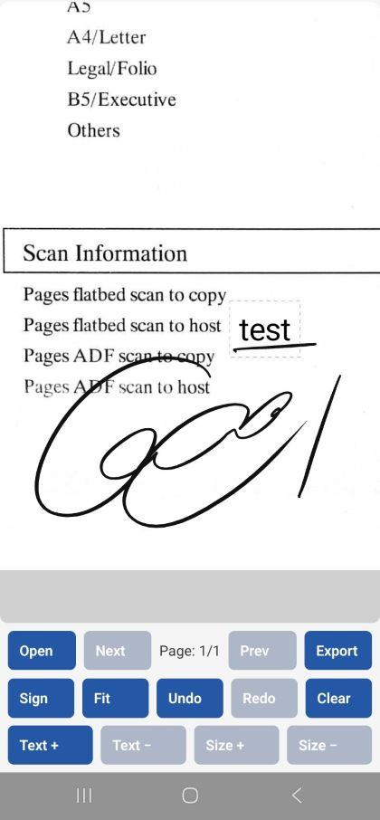

# @grego5/react-native-inksign-pdf

- Sign PDF documents with ink and text annotations.
- Open PDF or image files selected by your app.
- Add, remove, rotate, and reorder pages.
- Navigate pages, zoom, and undo or redo edits.
- Edit documents with or without a viewer.
- Focus searchable fields, page coordinates, or a location picked by the user.
- Export the signed document as a new PDF.



## Requirements

- Node.js 20
- Android 10/API 29 or newer
- iOS 16.0
- A native iOS or Android project

## Installation

```sh
npm install git+https://github.com/grego5/react-native-inksign-pdf.git
```

For iOS:

```sh
npx pod-install
```

The module requires a native React Native build; it is not supported in Expo
Go.

## Quick start

Open a PDF, draw a signature, place text, and save the result:

```tsx
import { useRef, useState } from 'react';
import { Button, Text, View } from 'react-native';
import {
  InkSignView,
  createDocument,
  type InkSignViewHandle,
  type ViewerState,
} from '@grego5/react-native-inksign-pdf';

export function SigningView() {
  const [document] = useState(() => createDocument());
  const pdf = useRef<InkSignViewHandle>(null);
  const [state, setState] = useState<ViewerState | null>(null);
  const [savedPath, setSavedPath] = useState('');

  async function savePdf() {
    const path = await document.finalize();
    if (path) setSavedPath(path);
  }

  return (
    <View style={{ flex: 1 }}>
      <InkSignView
        ref={pdf}
        document={document}
        onStateChange={(next) => {
          setState(next);
          if (next.error) console.error(next.error);
        }}
        style={{ flex: 1 }}
        strokeColor="#111827"
      />
      {state && state.pageIndex !== null && (
        <Text>
          Page {state.pageIndex + 1} of {state.pageCount}
        </Text>
      )}
      <Button title="Add pages" onPress={() => void document.addPages()} />
      <Button title="Draw" onPress={() => pdf.current?.setMode('ink')} />
      <Button title="Place text" onPress={() => pdf.current?.setMode('text')} />
      <Button
        title="Undo"
        onPress={async () => {
          if (state?.pageIndex != null) (await document.getPage(state.pageIndex)).undo();
        }}
      />
      <Button title="Save PDF" disabled={!state?.pageCount} onPress={() => void savePdf()} />
      {savedPath !== '' && <Text>Saved to {savedPath}</Text>}
    </View>
  );
}
```

`createDocument({ sources: [uri] })` returns immediately and loads in the background.
Omit sources to start empty. `addPages()` selects PDFs/images
natively; pass `sources` to bypass the picker. Images become contain-fitted A4 pages by default.
The viewer can mount with an empty owner or with `document` omitted.
Attach one viewer at a time. Unmounting keeps the document available for editing or another viewer.
Call `await document.close()` when finished. Keep or delete exported files yourself.

## Methods

Documents can be populated and edited without a mounted viewer. Native selection
requires a foreground presenter; explicit inputs do not.

### Document

- `createDocument({ sources?, type?, tag?, imagePageSize?, targetDpi?, jpegQuality?, recordHistory?, androidFallbackFont? }?)` —
  Return an owner immediately. Initial sources load before later asynchronous commands;
  `await document.getPage(0)` waits for them. Omitted sources or `[]` starts empty.
  Initial loading is clean; subsequent imports are structural edits. Load failures
  reach viewer state and reject dependent commands; close the failed owner when finished.
- `document.getState()` — Read document ID, page count, and dirty state.
- `document.getPage(indexOrTagQuery)` — Prepare a stable page handle.
- `document.getPageIdsByTag(tag)` — Read matching page IDs in document order.
- `document.loadFonts([{ name, uri }])` — Preload named fonts.
- `document.addPages({ sources?, type?, imagePageSize?, targetDpi?, jpegQuality?, tag? }?)` —
  Import PDFs/images in order. Omit sources to select natively; explicit sources
  bypass UI, and `sources: []` is a no-op. The first import populates an empty owner;
  later imports preserve viewer selection.
  User cancellation returns zero added pages with the current page count;
  lifecycle cancellation rejects `operation_cancelled`. Unsupported/type-mismatched
  content rejects `unsupported_content`; the complete import leaves state unchanged.
- `document.removePage(index)` — Remove a page, keeping at least one.
- `document.movePage(from, to)` — Reorder pages.
- `document.rotatePage(index, degrees)` — Rotate clockwise by 90, 180, or 270.
- `document.finalize()` — Export a caller-owned temporary PDF `file://` URI.
- `document.acceptChanges()` — Accept current content and page structure as clean;
  clear undo/redo. Does not save a file.
- `document.revertChanges()` — Discard tracked edits and restore accepted page
  structure, preserving untracked content.
- `document.close()` — End the document and invalidate its handles after admitted
  work finishes. Unmounting a viewer does not close its document.

### Page

- `page.getState()` — Read geometry, rotation, position/count, content, dirty state,
  and undo/redo availability.
- `page.resolveInputUnderline(options)` — Resolve a complete field label and its
  adjacent writing rule to a numeric text ID.
- `page.createInputArea({ bounds, ...options })` — Resolve a free text rectangle.
- `page.getTextValue(id)` — Read current entered text, then embedded source text,
  or `''` when empty.
- `page.setTextValue(id, text, options?)` — Write text; `''` removes module text and
  reveals any embedded source value.
- `page.setTextOptions(id, options)` — Change formatting.
- `page.adjustTextSize(id, delta)` — Adjust font size in page points.
- `page.getInputTarget(id)`, `page.getInputTargets()` — Inspect resolved targets.
- `page.undo()`, `page.redo()` — Undo/redo one completed edit.
- `page.clear()` — Clear editable ink and module text as one undoable operation.
- `page.clearInk()` — Clear only editable ink, preserving text/source PDF content.

Text options include direction, alignment, font, fontSize, color, maxLines and
verticalAnchor. Bounds use `{ x, y, width, height }` in displayed page points.
Bounds are hard limits; maxLines caps complete lines without forcing extra lines.
Manual placement accepts width and height independently: `{ width: 180 }` wraps
and grows vertically; `{ height: 60 }` grows horizontally within the page.
Text grows from logical start and top by default; snapped text grows above its rule.
History defaults to enabled. Set `recordHistory: false` when creating or opening the owner to disable it.
Programmatic `untracked: true` skips history unless the target already has tracked edits.

### Viewer and mode sessions

- `view.setMode('view' | 'ink' | 'text', options?)` — Enter a mode and return its
  session. Options configure text placement only; omission preserves the viewport.
- `view.selectPage(index)` — Select a page by zero-based index. After appending pages,
  use `pageCount - addedPageCount` for the first added page or `pageCount - 1` for the last.
- `view.nextPage()`, `view.previousPage()` — Navigate in document order.
- `view.getViewport()` — Read current focus and zoom.
- `view.focusInputTarget(page, id, options?)` — Select that page and focus its target.
  Options: zoom, verticalAnchor (`top`, `bottom`, `center`), edgeOffset in page points.
- `view.requestUserTap()` — Consume one valid page tap and return its coordinates.
  Page/mode changes or detach cancel it.
- `view.getSelectedText()` — Read native selection as a text handle or null.
- `text.getValue()`, `text.setValue(text, options?)`, `text.setOptions(options)`,
  `text.adjustSize(delta)` — Address that selected target after selection changes.

Mode sessions prevent delayed async follow-up work from running after the user
switches mode or detaches the view. They expose `getPage(query?)`,
`focusInputTarget(page, id, options?)`, `requestUserTap()`, and `setViewport(options?)`.
Sessions also expose `selectPage(index)`. An empty viewport object fits the page.
Session pages cancel with their session;
ordinary document pages remain usable independently. Catch cancellation with
`isOperationCancelled(error)`.

Android debug builds expose `startDebugRecording()`, `stopDebugRecording()`, and
`exportDebugRecording()` on the viewer ref.

## Events and configuration

- `onStateChange(state)` — Viewer mode, current page index, document ID/count,
  dirty state, and nullable error.
- `onPageChange(page)` — Current page ID, dimensions, rotation and undo/redo state.
- `onTextSelectionChange(selection)` — Selected page/text ID or null.
- `onZoomChange(zoom)` — Settled fit-relative zoom: 1 fits, above 1 zooms in.
- `textDirection="rtl"` — Default editor direction; omission/auto follows app layout.
  Per-operation direction overrides it.
- `pagerDirection="rtl"` — Paging direction independent of text direction.
- `strokeMaxWidth` — New-stroke width in screen points (default 4); nominal on iOS.
  `strokeMinWidth` and `strokeSmoothing` apply only to Android.

Viewer defaults apply to interactive edits. Document reads include active text;
finishing an edit records one undo action.

## Examples

### Update selected text

```ts
const text = pdf.current?.getSelectedText();
text?.setOptions({ alignment: 'center' });
// Remove module text:
text?.setValue('');
```

### Pick a signing location

```ts
import { isOperationCancelled } from '@grego5/react-native-inksign-pdf';

try {
  const session = view.setMode('ink');
  const target = await session.requestUserTap();
  await session.setViewport({ zoom: 3, x: target.x, y: target.y });
} catch (error) {
  if (!isOperationCancelled(error)) throw error;
}
```

### Select native document inputs

```ts
const document = createDocument();
const images = createDocument();
await document.addPages();
await images.addPages({ type: 'image' });
await document.addPages({ sources: [pdfUri] }); // explicit source bypasses UI
```

Native pickers support ordered multiple selection. On iOS, PDF requests use
Files; image/mixed requests offer Files or Photos. Close each owner when finished.

### Add image pages

```ts
await document.addPages({
  sources: [imagePath],
  imagePageSize: { width: 420, height: 594 },
});
```

### Fill an empty field

```ts
const page = await document.getPage(0);
const id = page.resolveInputUnderline({ fieldName: 'Name' });
if (!page.getTextValue(id).trim()) page.setTextValue(id, 'Ada Lovelace');
```

### Configure an Android fallback font

Pass one source URI: HTTP(S), a local file, Android content/resource URI, or an
Expo packaged asset. Android keeps the font in memory for the document session.

```tsx
const document = createDocument({ sources: [pdfUri], androidFallbackFont: { uri: fontUri } });
```

### Page tags

Pass `tag` to `createDocument()` or `document.addPages()` to label imported pages.
Query matches in current page order; tags are not saved in exported PDFs.

```ts
await document.addPages({ sources: [templateUri], tag: 'report' });
const ids = document.getPageIdsByTag('report');
if (ids.length > 0) {
  const page = await document.getPage({ tag: 'report' });
}
```

### Headless editing with a named font

```ts
import { createDocument } from '@grego5/react-native-inksign-pdf';

const document = createDocument({ sources: [file.uri] });
try {
  await document.loadFonts([{ name: 'template', uri: bundledFontUri }]);
  const page = await document.getPage(0);
  const id = page.createInputArea({ bounds: template.reportNumberBounds });
  page.setTextValue(id, report.number, {
    font: 'template',
    alignment: 'center',
    maxLines: 1,
  });
  const outputUri = await document.finalize();
} finally {
  await document.close();
}
```

Load a static `.ttf` from a local or bundled asset URI, then pass its name as
`font` when resolving or formatting text. Omit `font` to keep the
current selection; use `font: null` to restore the system font.

